  

# Awesome Commercial Fleet Telematics & Route Optimization

  
  
  
  
  
  
  
  

> 🚚 A curated collection of leading **Commercial Fleet Telematics**, **Driver Safety Scoring**, **Vehicle Routing Optimization (VRP)**, and **IoT Telemetry Analytics** SaaS platforms and open-source GitHub projects. 📡 🗺️

**Last updated: March 2026** ⏱️

This repository tracks enterprise **SaaS platforms** ☁️ and production-ready **open-source tools** 🛠️ engineered for commercial fleet telematics optimization, CAN-bus / OBD-II telemetry ingestion, Electronic Logging Device (ELD) compliance, in-cab AI vision safety monitoring, and vehicle routing problem (VRP) solving.

---

## 📑 Table of Contents

- [📊 Sector Overview & Market Dynamics](#-sector-overview--market-dynamics)
- [☁️ SaaS/Hosted Platforms](#️-saashosted-platforms)
- [🛠️ Open-Source GitHub Projects](#️-open-source-github-projects)
- [🏗️ Architecture & Integration Blueprint](#️-architecture--integration-blueprint)
- [🤝 How to Contribute](#-how-to-contribute)
- [⭐ Star History](#--star-history)
- [💖 Support & Community](#-support--community)
- [⚖️ Disclaimer](#️-disclaimer)

---

## 📊 Sector Overview & Market Dynamics

The global commercial fleet telematics market is valued at approximately **$65B – $75B** and is projected to surpass **$150B – $180B by the early 2030s**, expanding at a compound annual growth rate (**CAGR**) of **13% to 14.7%** 📈. The sector remains **moderately fragmented**—driven by diverse vehicle types, varying regional compliance regulations (such as FMCSA ELD, HOS, and digital tachograph mandates), and differing fleet sizes ranging from small local service fleets to multi-national freight carriers 🚛. While category giants (like Samsara, Geotab, and Verizon Connect) are driving steady industry consolidation through platform acquisitions, open APIs and OEM-embedded telematics prevent a winner-take-all monopoly, leaving substantial room for modular specialized SaaS providers and self-hosted open-source stacks 🌐.

---

## ☁️ SaaS/Hosted Platforms

The following table benchmarks category leaders in commercial fleet telematics, driver risk monitoring, and fleet management software. Platforms are ordered descending by corporate scale (market valuation / parent enterprise scale) 🏢.

| Platform | Company Scale (Valuation / Revenue) 💼 | Pricing (Starting Tiers) 💳 | Free Tier Limits / Trial Period ⏳ | Key Capabilities & Differentiators 🚀 |
| :--- | :--- | :--- | :--- | :--- |
| **[Samsara](https://www.samsara.com/)** | **~$24.3B Market Cap** (~$1.2B–$1.7B Annual Revenue) | **$27.00 – $33.00** per vehicle/month (base tracking; scales to $43.00+ with dual AI dash cams) | **No permanent free tier**; offers a **30-day hardware evaluation pilot** with dedicated sales onboarding and pre-provisioned demo gateways | Enterprise connected operations, real-time GPS tracking, AI dual-facing dash cams, voice driver coaching, ELD compliance, and open developer REST APIs. |
| **[Trimble Transportation](https://transportation.trimble.com/)** | **~$14.0B Market Cap** (~$3.6B–$3.8B Annual Revenue) | **$35.00 – $60.00** per vehicle/month (enterprise trucking & routing tiers) | **No permanent free tier**; provides **custom scoped multi-week sandbox pilot** for enterprise carrier trials | End-to-end transportation management systems (TMS), commercial vehicle navigation, ELD compliance, telematics, and heavy-duty logistics workflows. |
| **[Motive (KeepTruckin)](https://gomotive.com/)** | **~$2.85B Valuation** (~$600M ARR) | **$25.00 – $40.00** per vehicle/month (Starter to Enterprise safety bundles) | **No permanent free tier**; provides a **14-day assisted pilot evaluation** with complimentary loaner hardware for qualified commercial fleets | AI dash cams detecting distracted driving/cellphone usage, automated driver safety coaching scores, IFTA fuel tax automation, and dispatch workflows. |
| **[Fleetio](https://www.fleetio.com/)** | **~$1.50B Valuation** (~$58M+ ARR) | **$4.00 – $5.00** per vehicle/month (Essential plan, billed annually/monthly) | **No permanent free tier**; offers a **14-day full-featured free trial** (unlimited vehicles and inspection forms, no credit card required) | Modern cloud fleet maintenance software, work order management, parts inventory tracking, preventative maintenance schedules, and third-party telematics integrations. |
| **[Geotab](https://www.geotab.com/)** | **~$1.00B+ Valuation** (~$970M Annual Revenue) | **$20.00 – $40.00** per vehicle/month (GO Core to GO Full regulatory packages via authorized resellers) | **No permanent free tier**; offers a **21-day to 30-day pilot trial** via certified reseller partners including GO9 test units | Patented curve-based telemetry logging, OEM-embedded hardware-free telematics, EV battery analytics, and comprehensive engine fault diagnostics. |
| **[Verizon Connect](https://www.verizonconnect.com/)** | **~$1.00B+ Unit Revenue** (Part of Verizon Communications, ~$138B Revenue) | **$30.00 – $45.00** per vehicle/month (Reveal GPS fleet tracking tiers) | **No permanent free tier**; offers **guided live demo sandboxes** and selective **30-day proof-of-concept (PoC) trials** for multi-vehicle contracts | Enterprise GPS fleet tracking, driver behavior monitoring, fuel card integration, route dispatch, and roadside diagnostics. |
| **[Platform Science](https://www.platformscience.com/)** | **~$575M Valuation** (~$115M–$190M ARR) | **$20.00 – $35.00** per active vehicle/month (utilization-based pricing; billed only when vehicle exceeds 10 miles/month) | **No permanent free tier**; provides a **30-day enterprise fleet field trial** on OEM factory-installed telematics | Open vehicle platform and app marketplace integrating directly with factory-installed truck hardware (Daimler, PACCAR, Navistar), eliminating aftermarket dongles. |
| **[Webfleet](https://www.webfleet.com/)** | **~$200M+ Unit Revenue** (Part of Bridgestone Corporation) | **$25.00 – $45.00** per vehicle/month (Link tracking and advanced OptiDrive 360) | **No permanent free tier**; offers a **14-day to 30-day structured hardware pilot** through accredited regional fleet partners | European and global telematics leader, OptiDrive 360 driver safety scoring, professional truck navigation, tire pressure monitoring, and EV fleet management. |
| **[Omnitracs](https://omnitracs.com/)** | **~$80M+ Standalone Revenue** (Part of Solera Holdings, acquired in multi-billion deal) | **$23.00 – $35.00** per vehicle/month (IVG & XRS telematics/compliance packages) | **No permanent free tier**; provides **scheduled interactive live platform demos** and bespoke enterprise pilot programs | Pioneer in commercial trucking telematics, hours-of-service (HOS) compliance, video-based safety intelligence, and fleet navigation. |
| **[Teletrac Navman](https://www.teletracnavman.com/)** | **~$75M+ Unit Revenue** (Part of Vontier Corp, NYSE: VNT) | **$25.00 – $35.00** per vehicle/month (TN360 AI fleet tracking & compliance) | **No permanent free tier**; offers **14-day sales-assisted live test drives** and virtual environment sandbox testing | TN360 AI-powered telematics platform, real-time safety scores, vehicle maintenance scheduling, and digital forms workflow. |

---

## 🛠️ Open-Source GitHub Projects

Explore curated open-source projects for self-hosted GPS tracking, vehicle routing problem (VRP) solving, driver safety analytics, and telematics pipelines. Repositories are ranked descending by GitHub stargazer count ⭐.

- **[Project-OSRM / osrm-backend](https://github.com/Project-OSRM/osrm-backend)**   
  High-performance Open Source Routing Machine (C++) designed to run on OpenStreetMap (OSM) data. Computes lightning-fast shortest paths, multi-vehicle distance-duration matrices, and turn-by-turn navigation instructions for large commercial fleets 🛣️.

- **[traccar / traccar](https://github.com/traccar/traccar)**   
  Leading open-source modern GPS tracking and fleet management platform (Java). Supports over 200+ telematics communication protocols and thousands of GPS tracking device models, featuring real-time map tracking, geofencing, trip history playback, and comprehensive telemetry event alerts 🛰️.

- **[graphhopper / graphhopper](https://github.com/graphhopper/graphhopper)**   
  Fast, memory-efficient routing engine and vehicle routing problem solver (Java). Powers commercial fleet routing, turn-by-turn navigation, isochrone calculation, and customizable truck profiles (height, weight, axle load restrictions) 🚚.

- **[openremote / openremote](https://github.com/openremote/openremote)**   
  100% open-source IoT device management and telemetry automation platform (Java). Serves as an enterprise foundation for connected vehicle data pipelines, protocol integration, rules engines, asset tracking, and customizable dashboards 🌐.

- **[VROOM-Project / vroom](https://github.com/VROOM-Project/vroom)**   
  High-performance Vehicle Routing Open-source Optimization Machine (C++). Solves complex Vehicle Routing Problems (VRP, CVRP, VRPTW) in milliseconds, optimizing delivery sequences, vehicle capacities, and time windows while integrating natively with OSRM and GraphHopper matrices ⚡.

- **[pgRouting / pgrouting](https://github.com/pgRouting/pgrouting)**   
  Geospatial routing extension for PostgreSQL and PostGIS. Adds shortest path (Dijkstra, A*, traveling salesperson), driving distance calculations, and graph analysis directly inside relational databases for spatial fleet analysis 🗺️.

- **[itinero / routing](https://github.com/itinero/routing)**   
  Modular and cross-platform routing library built in C#/.NET for OpenStreetMap data. Ideal for mobile and embedded fleet devices requiring offline route calculation, multimodal journey planning, and custom vehicle constraints 📱.

- **[Inferensys / ai-driver-safety](https://github.com/Inferensys/ai-driver-safety)**   
  Intelligent computer-vision driver monitoring system. Analyzes in-cabin video streams to construct a frame-by-frame risk timeline for eye closure, yawning, drowsiness, and mobile phone distraction at up to 128 FPS on edge hardware using MediaPipe 👁️.

- **[connor-makowski / scgraph](https://github.com/connor-makowski/scgraph)**   
  Lightweight Python shortest-path routing tool for transportation networks and supply chain operations (developed with MIT CTL and Kühne Logistics University). Generates offline road, rail, maritime, and multimodal routes for supply chain simulation 🚢.

- **[openremote / fleet-management](https://github.com/openremote/fleet-management)**   
  Reference open-source fleet management application built atop OpenRemote. Demonstrates live OBD-II device integration, automated geofence alerts, fuel/battery telemetry monitoring, and vehicle health dashboarding 🔌.

- **[philippnormann / ev-charging-optimization](https://github.com/philippnormann/ev-charging-optimization)**   
  Electric vehicle fleet routing and charging schedule optimizer using Ant Colony Optimization (ACO) algorithms to balance charging downtime, battery degradation, and delivery deadlines 🔋.

- **[AkashKabra11 / Driver-Behavior-Scoring](https://github.com/AkashKabra11/Driver-Behavior-Scoring)**   
  Driver behavior analysis and safety risk scoring module built on vehicle sensor telemetry (acceleration, harsh braking, cornering) to compute risk profiles for fleet insurance and driver safety evaluation 🚦.

- **[Sid-Romero / fleetpulse](https://github.com/Sid-Romero/fleetpulse)**   
  Full-stack real-time IoT fleet management platform (MIT) engineered with Go, React, PostgreSQL, and WebSockets. Features live telemetry ingestion, vehicle health monitoring, alert escalation workflows, and Prometheus/Grafana observability 📊.

- **[JayDS22 / Driver-Behavior-Analytics-System](https://github.com/JayDS22/Driver-Behavior-Analytics-System)**   
  Statistical driver risk analytics framework combining Cox proportional hazards modeling (C-index: 0.79) and Bayesian hierarchical models (91.4% accuracy). Features sub-200ms scoring latency, SHAP model explainability, and Docker/Kubernetes deployment manifests 🧠.

- **[Logistics-Living-Lab / sucolo-routing-frontend](https://github.com/Logistics-Living-Lab/sucolo-routing-frontend)**   
  Specialized routing frontend prototype for urban cargo bike logistics and sustainable last-mile delivery, factoring in cycleway infrastructure and urban vehicle constraints 🚲.

---

## 🏗️ Architecture & Integration Blueprint

For engineering teams looking to design an enterprise-grade, self-hosted commercial fleet optimization platform without proprietary vendor lock-in, the open-source projects above can be combined into a modular stack 🧩:

1. **Telemetry Ingestion & Device Management**: Use **Traccar** or **OpenRemote** to interface with physical OBD-II / J1939 CAN-bus dongles, GPS trackers, and mobile telematics SDKs.
2. **Matrix Computation & Road Network Graphing**: Run **OSRM** or **GraphHopper** self-hosted on local OpenStreetMap extracts to generate vehicle-specific travel time matrices and turn-by-turn routing paths.
3. **Multi-Stop Route & Fleet Dispatch Optimization**: Pipe fleet positions and dispatch orders into **VROOM** to solve Capacitated Vehicle Routing Problems with Time Windows (VRPTW) in sub-second runtimes.
4. **Safety & Risk Scoring**: Ingest IMU sensor data, acceleration vectors, and dashcam video into **Driver-Behavior-Analytics-System** or **ai-driver-safety** for real-time driver safety coaching and insurance risk profiling.
5. **Data Persistence & Real-Time Dashboards**: Store historical timeseries telemetry in **PostgreSQL + TimescaleDB** (leveraging **pgRouting** for spatial queries) and display live fleet vitals using **Grafana** or a custom **React / Go (FleetPulse)** UI.

---

## 🤝 How to Contribute

1. Fork this repository 🍴.
2. Add or update entries in [README.md](file:///C:/Users/ishan/Documents/Projects/Awesome-Commercial-Fleet-Telematics-Optimization/README.md) following the existing tabular or badge format ✍️.
3. Ensure all links are active and provide factual, objective details regarding functionality, pricing, or star badges 🔍.
4. Submit a Pull Request with a concise summary of the addition or revision 🚀.

---

##  Star History

---

## 💖 Support & Community

Thank you for visiting and supporting the **Commercial Fleet Telematics & Route Optimization** ecosystem! 🙌

If you found this curated resource helpful:
- ⭐ **Star this repository** to help others discover it!
- 🍴 **Fork it** to customize or build your own telematics stack.
- 📢 **Share it** with fellow fleet managers, logistics engineers, and software developers.
- ☕ If you'd like to support ongoing curation and open-source maintenance, consider buying a coffee via the [GitHub Sponsors Dashboard](https://github.com/sponsors/ishandutta2007). Every bit of support is deeply appreciated!

---

## ⚖️ Disclaimer

- This list is community-curated and provided for informational purposes only. Mentions do not constitute commercial endorsement 🛡️.
- Fleet telematics and driver monitoring systems collect personally identifiable information (PII) and location data. Ensure your deployments comply with relevant legal frameworks (e.g., GDPR, CCPA/CPRA, FMCSA ELD regulations, and union agreements) 🔒.
- Always test open-source algorithms and routing solvers thoroughly against real-world operational constraints before executing autonomous fleet dispatch ⚠️.
